# KẾ HOẠCH TRIỂN KHAI DỰ ÁN VÀ PHÂN RÃ CÔNG VIỆC CHI TIẾT (WBS)
## Project: EMPLOYEE WORKING HOURS AND SALARY MANAGEMENT

---

## PHẦN 1: THƯ VIỆN CẦN THIẾT CHO PROJECT

Dự án hiện tại đã có Jetpack Compose và Material 3. Dưới đây là các thư viện đã được cấu hình:

### 1. Bảng danh sách thư viện

| Thư viện | Mục đích sử dụng | Trạng thái |
| :--- | :--- | :---: |
| **Material Icons Extended** | Cung cấp đầy đủ icon (`Search`, `Person`, `Lock`, `Timer`, `Check`, `Edit`, `Delete`, `AttachMoney`, `History`, v.v.) không cần tải SVG thủ công. | **Đã cấu hình** |
| **Navigation Compose** | Quản lý chuyển màn hình giữa Login $\rightarrow$ Admin Dashboard $\rightarrow$ Employee Dashboard. | **Đã cấu hình** |
| **SQLiteOpenHelper** (Built-in Android SDK) | Lưu trữ 4 bảng CSDL mà **không cần cài thêm dependency**, tránh rủi ro lỗi đồng bộ KSP trong phòng thi. | **Sử dụng trực tiếp** |

---

## PHẦN 2: LỘ TRÌNH TRIỂN KHAI THEO DÒNG THỜI GIAN (TIMELINE)

Dự kiến hoàn thành trong **90 - 110 phút** để tối ưu điểm số "thời gian nhanh nhất":

```mermaid
gantt
    title TIẾN ĐỘ THỰC HIỆN DỰ ÁN (SPEED-RUN)
    dateFormat  m
    axisFormat %M ph
    
    section Giai đoạn 1: Base
    Cấu hình Lib & Database 4 bảng          :active, d1, 0, 20m
    Thiết lập PrefManager & Data Seeder      :d2, 10, 20m
    
    section Giai đoạn 2: Song song
    Member 1 - Login & Auth Navigation       :d3, 20, 45m
    Member 2 - CRUD & Search Nhân viên       :d4, 20, 60m
    Member 3 - Chấm công (Check-in/out + Valid) :d5, 20, 60m
    Member 2 - Quản lý & Tính lương công ty  :d6, 60, 85m
    Member 3 - Lịch sử công & Lương cá nhân  :d7, 60, 85m
    
    section Giai đoạn 3: Tích hợp
    Ghép luồng & Kiểm thử Validation         :crit, d8, 85, 100m
    Review checklist & Sẵn sàng nộp bài     :d9, 100, 110m
```



---

## PHẦN 3: ĐẦU MỤC CÔNG VIỆC CHI TIẾT TỪNG THÀNH VIÊN (NHÓM 3 NGƯỜI)

> [!TIP]
> Mô hình 3 người được phân tách theo **Domain Package riêng biệt** giúp các thành viên commit code thoải mái mà **100% không bị Git Merge Conflict**.

---

### 👨‍💻 THÀNH VIÊN 1: DATA CORE, SESSION & XÁC THỰC (CORE LEAD)
*Chịu trách nhiệm toàn bộ nền tảng dữ liệu cho cả nhóm và phân quyền người dùng.*

- **Thư mục phụ trách**:
  - `app/src/main/java/com/example/th_app2/data/db/`
  - `app/src/main/java/com/example/th_app2/data/model/`
  - `app/src/main/java/com/example/th_app2/data/pref/`
  - `app/src/main/java/com/example/th_app2/ui/auth/`

| Mã Task | Tên đầu mục công việc | Mô tả chi tiết & Output cần đạt | Tiêu chí nghiệm thu (Acceptance Criteria) |
| :--- | :--- | :--- | :--- |
| **T1.1** | **Tạo Database 4 bảng** | Viết `DatabaseHelper.kt` tạo 4 bảng: `Account`, `Employee`, `WorkLog`, `Salary` với đầy đủ PK, FK và kiểu dữ liệu. | `onCreate()` tạo đủ 4 bảng không văng lỗi khi chạy app lần đầu. |
| **T1.2** | **Bộ Seeder dữ liệu mẫu** | Viết hàm `seedSampleData()` tự động nạp khi DB rỗng:<br>- 1 Admin (`admin`/`123456`)<br>- 2 Employee (`emp1`/`123456`, `emp2`/`123456`)<br>- 3 bản ghi WorkLog mẫu tháng hiện tại. | Khi vừa cài app là có sẵn tài khoản để login test ngay lập tức mà không cần tạo tay. |
| **T1.3** | **Quản lý Session (`PrefManager`)** | Dùng `SharedPreferences` để lưu:<br>`isLoggedIn`, `userId`, `employeeId`, `username`, `role`.<br>Viết hàm `saveSession()`, `getSession()`, `clearSession()`. | Tắt app bật lại không bắt đăng nhập lại; bấm Logout xóa sạch session. |
| **T1.4** | **Màn hình Đăng nhập (Login)** | UI gồm: Tên đăng nhập, Mật khẩu, nút Đăng nhập.<br>Logic: Kiểm tra DB, lưu vào `PrefManager`, điều hướng vào Admin hoặc Employee Dashboard tương ứng. | - Sai tài khoản $\rightarrow$ Toast báo lỗi.<br>- Đúng Admin $\rightarrow$ Mở Admin Screen.<br>- Đúng Employee $\rightarrow$ Mở Employee Screen. |
| **T1.5** | **UI Khung & Điều hướng chung** | Cấu hình NavHost/State Navigation và Header chung (có hiển thị tên người dùng và nút Logout). | Điều hướng mượt mà, chuyển đổi qua lại giữa các màn hình đúng role. |

---

### 👨‍💼 THÀNH VIÊN 2: ADMIN MODULE (QUẢN LÝ NHÂN VIÊN & LƯƠNG TOÀN CÔNG TY)
*Chịu trách nhiệm toàn bộ tính năng của Quản trị viên (Admin).*

- **Thư mục phụ trách**:
  - `app/src/main/java/com/example/th_app2/ui/admin/employee/`
  - `app/src/main/java/com/example/th_app2/ui/admin/salary/`

| Mã Task | Tên đầu mục công việc | Mô tả chi tiết & Output cần đạt | Tiêu chí nghiệm thu (Acceptance Criteria) |
| :--- | :--- | :--- | :--- |
| **T2.1** | **Danh sách Nhân viên (View List)** | Hiển thị danh sách nhân viên dạng Card: Mã NV, Tên, Email, SĐT, Mức lương/giờ (`hourlyRate`), Tên tài khoản liên kết. | Load dữ liệu từ bảng `Employee` lên LazyColumn rõ ràng, đẹp mắt. |
| **T2.2** | **Thêm mới Nhân viên (Add Employee)** | Mở Dialog / Màn hình form thêm:<br>- Thông tin NV: Mã, Tên, Email, SĐT, `hourlyRate`.<br>- Tài khoản liên kết: Tự động tạo `Account` tương ứng với Role `EMPLOYEE`. | Validate: Không được để trống; Mã NV không được trùng; `hourlyRate` phải là số $> 0$. |
| **T2.3** | **Sửa & Xóa Nhân viên (Update & Delete)** | - Cho phép sửa thông tin cá nhân và `hourlyRate`.<br>- Cho phép xóa nhân viên (hiển thị Dialog xác nhận trước khi xóa). | Dữ liệu cập nhật ngay trên danh sách; Xóa thành công bản ghi khỏi DB. |
| **T2.4** | **Tìm kiếm Nhân viên (Search)** | Ô Search bar phía trên danh sách: Tìm kiếm tức thì theo **Tên** hoặc **Mã nhân viên** (`LIKE %keyword%`). | Gõ ký tự nào danh sách lọc theo thời gian thực (Real-time filter). |
| **T2.5** | **Quản lý & Kích hoạt Tính lương** | - Nút **"Tính lương tháng"** (chọn Tháng/Năm): Duyệt qua toàn bộ NV, tính tổng `totalHours` và `overtimeHours` từ `WorkLog` để insert/update vào bảng `Salary`.<br>- Hiển thị bảng tổng hợp lương toàn bộ nhân viên. | Tính chính xác: $Lương = (Tổng\ giờ \times hourlyRate) + (Giờ\ OT \times hourlyRate \times 1.5)$. |

---

### 👷‍♂️ THÀNH VIÊN 3: EMPLOYEE MODULE (CHẤM CÔNG & LƯƠNG CÁ NHÂN)
*Chịu trách nhiệm toàn bộ tính năng của Nhân viên (Employee).*

- **Thư mục phụ trách**:
  - `app/src/main/java/com/example/th_app2/ui/employee/attendance/`
  - `app/src/main/java/com/example/th_app2/ui/employee/history/`
  - `app/src/main/java/com/example/th_app2/ui/employee/salary/`

| Mã Task | Tên đầu mục công việc | Mô tả chi tiết & Output cần đạt | Tiêu chí nghiệm thu (Acceptance Criteria) |
| :--- | :--- | :--- | :--- |
| **T3.1** | **Giao diện Chấm công (Check-in/out)** | - Hiển thị Ngày hiện tại, Đồng hồ thời gian thực.<br>- 2 nút lớn: **Check-in** và **Check-out**.<br>- Trạng thái hiện tại: *"Chưa vào ca"*, *"Đang làm việc"*, *"Đã hoàn thành ca"*. | Trực quan, người dùng nhìn vào biết ngay trạng thái hôm nay của mình. |
| **T3.2** | **Logic Check-in & Ràng buộc chống trùng** | Khi bấm **Check-in**:<br>- Lấy ngày hiện tại `YYYY-MM-DD` và giờ hiện tại `HH:mm:ss`.<br>- **Validation**: Kiểm tra nếu ngày hôm nay đã có bản ghi `WorkLog` thì **chặn lại** và thông báo lỗi. | Không thể bấm Check-in 2 lần trong 1 ngày; Sau khi check-in thì nút Check-in bị Disable. |
| **T3.3** | **Logic Check-out & Tính giờ làm** | Khi bấm **Check-out**:<br>- **Validation**: Không cho bấm nếu chưa Check-in.<br>- Ghi nhận `checkOutTime`.<br>- Tự động tính: $\text{totalHours} = \text{checkOut} - \text{checkIn}$ (dạng thập phân, ví dụ 8.5 giờ). | Cập nhật `totalHours` vào `WorkLog`, chuyển trạng thái thành `COMPLETED`. |
| **T3.4** | **Xem Lịch sử Điểm danh (WorkLog History)** | Danh sách các ngày đã làm việc trong tháng: Ngày, Giờ vào, Giờ ra, Tổng giờ làm. Có bộ lọc theo Tháng/Năm. | Hiển thị chính xác lịch sử điểm danh của chính nhân viên đó, không thấy của người khác. |
| **T3.5** | **Xem Bảng lương Cá nhân (Personal Salary)** | Hiển thị thẻ tóm tắt tháng hiện tại:<br>- Tổng giờ làm việc thường.<br>- Số giờ Overtime ($> 8h/\text{ngày}$).<br>- Mức lương theo giờ.<br>- **Tổng lương thực nhận**. | Nhân viên xem được chi tiết thu nhập của mình theo đúng công thức đề bài. |

---

## PHẦN 4: HỢP ĐỒNG DỮ LIỆU CHUNG (CONTRACT INTERFACE)
*Để Thành viên 2 và 3 có thể code giao diện ngay mà không cần đợi Thành viên 1 viết xong database:*

```kotlin
// Thành viên 1 cam kết cung cấp các hàm sau trong DatabaseHelper:
interface AppRepository {
    // Auth & Session
    fun login(username: String, password: String): Account?
    fun getEmployeeByAccountId(accountId: Int): Employee?
    
    // Member 2 (Admin) cần gọi:
    fun getAllEmployees(): List<Employee>
    fun searchEmployees(query: String): List<Employee>
    fun insertEmployee(emp: Employee, acc: Account): Boolean
    fun updateEmployee(emp: Employee): Boolean
    fun deleteEmployee(empId: Int): Boolean
    fun calculateMonthlySalary(month: Int, year: Int)
    fun getAllSalaries(month: Int, year: Int): List<SalaryDetailDto>
    
    // Member 3 (Employee) cần gọi:
    fun getTodayWorkLog(employeeId: Int): WorkLog?
    fun doCheckIn(employeeId: Int): Boolean
    fun doCheckOut(employeeId: Int): Boolean
    fun getWorkLogsByEmployee(employeeId: Int, month: Int, year: Int): List<WorkLog>
    fun getSalaryByEmployee(employeeId: Int, month: Int, year: Int): Salary?
}
```

---

## PHẦN 5: CHECKLIST TRƯỚC KHI BẤM NỘP BÀI

- [ ] Đã thêm icon và navigation vào `build.gradle.kts` và sync thành công.
- [ ] Chạy lần đầu tiên app có sẵn dữ liệu test (Admin + 2 Employee).
- [ ] Đăng nhập đúng điều hướng vào 2 Role khác nhau.
- [ ] Kiểm tra lỗi Check-in 2 lần trong ngày $\rightarrow$ Bị chặn đúng quy định.
- [ ] Kiểm tra lỗi Check-out khi chưa Check-in $\rightarrow$ Bị chặn đúng quy định.
- [ ] Bấm tính lương Admin $\rightarrow$ Nhân viên mở tab Lương thấy ngay số tiền được tính.
- [ ] Xóa app hoặc kill app $\rightarrow$ Mở lại vẫn nhớ phiên đăng nhập (SharedPreferences).
